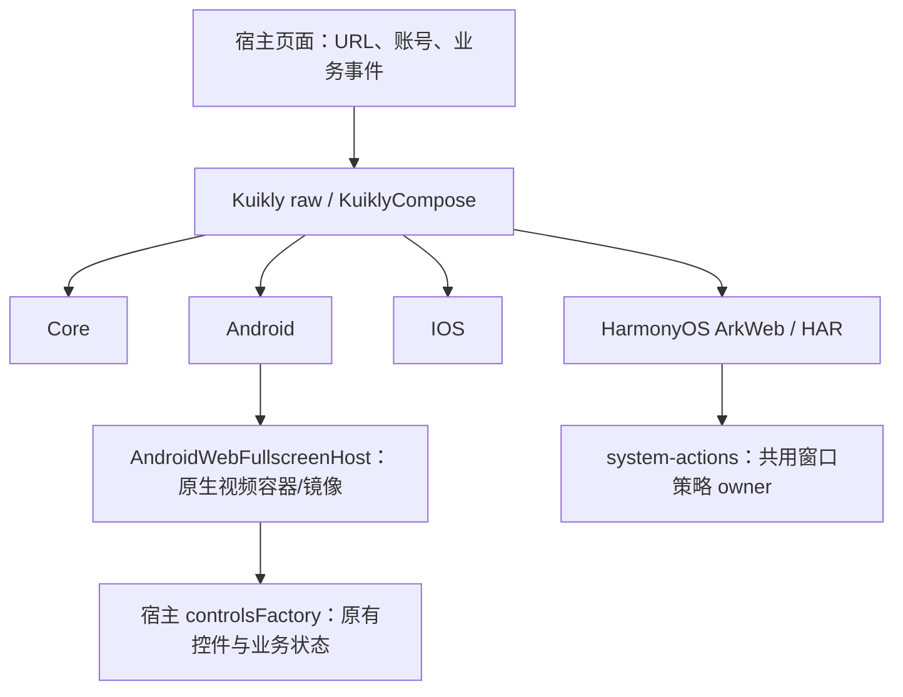
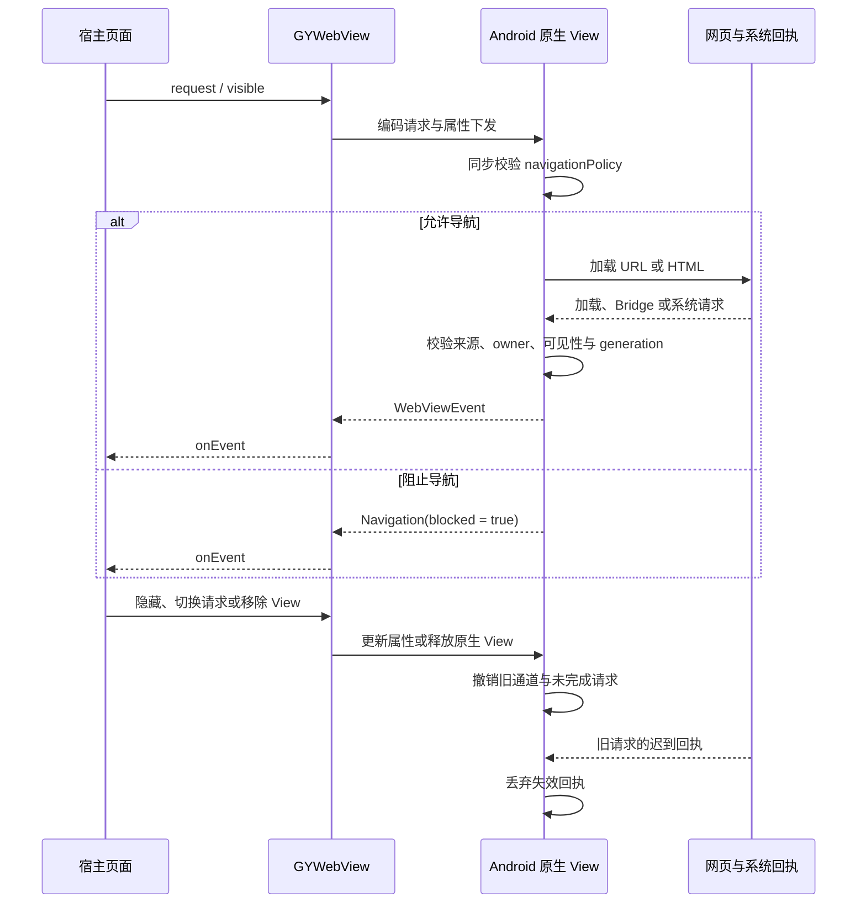
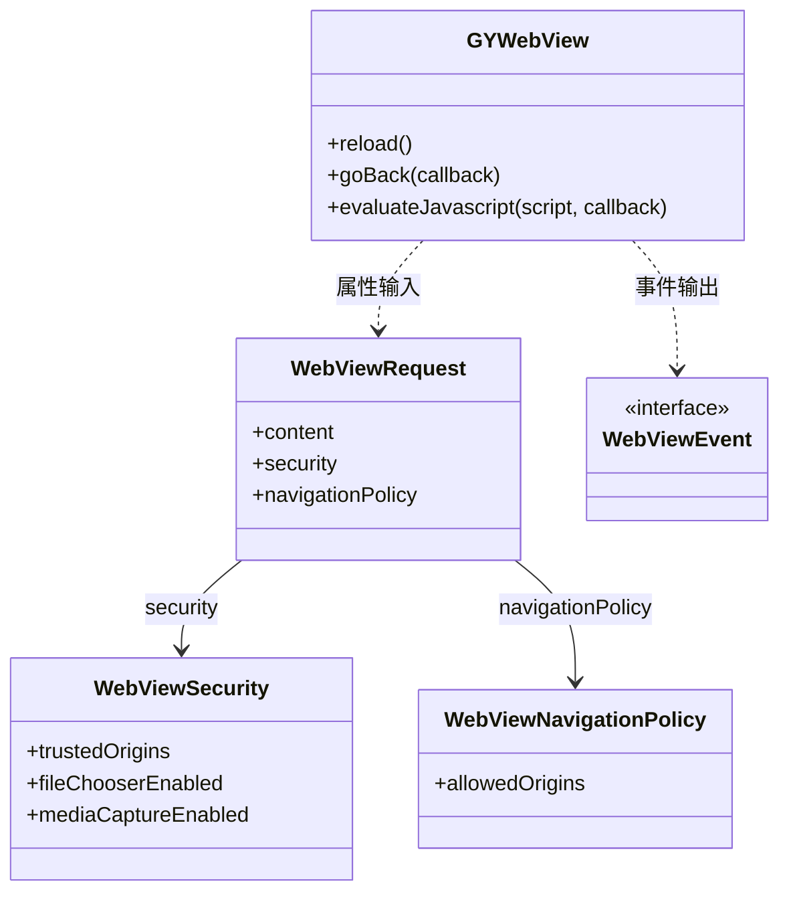

# GY CrossKit WebView

当前开发分支的 Kuikly 与宿主统一：KMP 使用 `2.29.1-2.0.21-ohos`，iOS/OHOS Renderer 使用 `2.29.1`。以后随宿主同步升级；本轮权限回执调整尚未发布，既有 `1.1.0` 的接入与验收记录以对应 tag 为准。

本轮基于既有 `1.1.0` 的未发布改动，新版本号待验证后冻结；旧 `1.1.0` 不包含本轮权限回执修复，须完成新源码验证、重新打包与精确产物消费后再发布。根目录只聚合构建，不再发布 `compose-webview` CMP UI 产物；公开 Kotlin 能力保留 `webview-core` 与 `webview-kuikly`。旧 CMP 使用方继续使用固定旧版本；本候选删除根包的 `AppWebView`、`AppWebViewState` 与 `WebViewCallbacks`，不提供兼容空壳。

`webview-kuikly` 保留 raw `GYWebView` 和 `io.github.gycrosskit.composewebview.kuikly.AppWebView` KuiklyCompose 入口，传递 KuiklyCompose / Compose runtime。宿主继续统一 Kuikly、compiler 与 Renderer 版本；`verifyNoCmpUi` 允许这套 runtime 并拒绝第二套 AndroidX/JetBrains CMP UI/foundation/material。

HAR `1.1.0` 候选包含按 WindowStage 注入窗口策略，system-actions-native 精确依赖 `1.0.1`，依赖升级后须重新编译和冻结；本轮同时包含 Kotlin 生命周期入口、跨平台来源策略和原生错误分类修订。Maven / Git Pod 使用新标签 `1.1.0`，HAR 使用独立标签 `har-1.1.0`，保留既有 `1.0.2`、`har-1.0.2` 及更早标签和制品摘要。Pod、HAR、Registry 与 Maven 消费分别以本轮真实收据确认。旧版本及 CMP 验收保留在 [rc.18 发布记录](docs/0.2.0-rc.18发布验收.md)、[历史源码审查](docs/完整源码审查.md) 和旧 tag 中，不代表本候选通过验证。

底层使用 Android WebView、iOS WKWebView 和 HarmonyOS ArkWeb。请求、安全、导航、脚本与事件由 core 共享，账号、鉴权、品牌 URL、页面状态与业务路由由宿主提供。H5 视频控制保留 core 媒体脚本/镜像、Android 原生控件与 KuiklyCompose overlay；不改系统播放器层级限制。

iOS 常规网页最低 15.0；受控文件选择要求 iOS18.4+，旧系统关闭本次文件选择并报告 Unsupported，页面继续加载；DOM 拦截不保证旧 WebKit 原生文件隔离。MP4-only 上传保留 MOV 转换及输入/输出各 50 MiB 限制，转码过程磁盘不承诺硬上限。完整合同见 [功能与平台差异](docs/功能与平台差异.md)。

迁移与本轮渠道组合见 [RC 迁移说明](docs/RC迁移说明.md)。

## 架构与调用流程

先看 UI 入口，再看原生接线：Kuikly raw 与 KuiklyCompose 共用 `webview-core` 的请求与事件，由各平台 native 接线管理原生 View。业务 URL、账号、导航处理和页面状态由宿主提供。



KMP 产物提供 core 与 Kuikly API；宿主仍需注册同名原生 View，iOS 配 Pod，HarmonyOS 配 HAR。

下面以 Kuikly Android 为例：导航规则预先下发，在原生同步判断；事件返回宿主用于观察。Bridge、文件与媒体请求另行校验可信来源，导航规则不等于高权限授权。



类图只保留接入时需要理解的公共类型；虚线表示使用关系，实线表示请求中的字段引用。



源码入口：[请求与安全](webview-core/src/commonMain/kotlin/io/github/gycrosskit/composewebview/WebViewRequest.kt)、[导航规则](webview-core/src/commonMain/kotlin/io/github/gycrosskit/composewebview/WebViewNavigationPolicy.kt)、[KuiklyCompose 入口](webview-kuikly/src/commonMain/kotlin/io/github/gycrosskit/composewebview/kuikly/AppWebView.kt)、[raw 入口](webview-kuikly/src/commonMain/kotlin/io/github/gycrosskit/composewebview/kuikly/GYWebView.kt)、[Android native](webview-kuikly/src/androidMain/kotlin/io/github/gycrosskit/composewebview/kuikly/GYWebViewNative.kt)。controller 属于当前节点，命令异步返回。

具名早期双向消息通道自 Maven / Git Pod rc.13 与 OHOS HAR rc.12 提供，当前 Maven / Git Pod / HAR 统一准备 `1.1.0` 未发布候选：`pageMessageChannels` 显式指定 `window[channel].postMessage(string)` / `onmessage(event.data)`，默认关闭；宿主用单次 `replyPageMessage` 回复。三端仅初始完整 HTTP(S) 主页面获得 capability；文档身份仅规范化 scheme/host 大小写、默认端口和空路径，path/query/fragment 保留原字节，`navigationPolicy.allowedUrls` 仍匹配实际 URL 原字符串。隐藏、停止和后续导航撤销；恢复必须显式 reload 重建 owner。接线与边界见[接入指南](docs/接入指南.md#具名早期双向页面通道)。

## 平台与模块

| 平台 | 入口 | 最低要求 |
| --- | --- | --- |
| Android | `webview-kuikly` | API 24；Kuikly 原生能力使用 ComponentActivity |
| iOS | Kuikly KLIB + `GYWebView` Pod | iOS 15；原生文件选择要求 iOS 18.4+ |
| HarmonyOS | `webview-kuikly` KLIB + `@gycrosskit/webview` HAR | HarmonyOS 6.0.2 / API 22；Kuikly render 2.29.1 |

UI 无关契约位于 `webview-core`，由 UI 模块传递依赖。当前候选工具链：Kotlin `2.2.21-1.0.0`、Kuikly core `2.29.1-2.0.21-ohos`；OHOS 插件及传递依赖仓库见 [接入指南](docs/接入指南.md#ohos-工具链仓库)。

## 安装

在 `settings.gradle.kts` 的依赖仓库中加入：

```kotlin
dependencyResolutionManagement {
    repositories {
        google()
        mavenCentral()
        maven("https://jitpack.io") {
            content { includeGroup("com.github.gycrosskit.compose-webview") }
        }
        maven("https://maven.eazytec-cloud.com/nexus/repository/maven-public/")
        maven("https://mirrors.tencent.com/nexus/repository/maven-public/")
        maven("https://mirrors.tencent.com/nexus/repository/maven-tencent/")
    }
}
```

以下 Maven / Git Pod / OHOS HAR 统一准备 `1.1.0`；各渠道分别按真实构建、不可变 Release 与精确公开消费收据确认。在 KMP 的 `commonMain.dependencies` 接入：

```kotlin
// Kuikly Android/iOS/HarmonyOS
implementation("com.github.gycrosskit.compose-webview:webview-kuikly:1.1.0")
```

iOS Kuikly 另外安装原生 Pod；它不替代 KMP 依赖：

```ruby
pod 'GYWebView', :git => 'https://github.com/gycrosskit/compose-webview.git', :tag => '1.1.0'
```

当前源码另含 iOS Renderer 2.29 兼容候选；发布 Tag 与候选提交的消费边界见
[Renderer 依赖约束](docs/功能与平台差异.md#renderer-依赖约束)。

HarmonyOS HAR `1.1.0` 候选安装见[HAR 接入指南](ohos/webview-native/README.md)，Registry 可安装性须单独核验。历史 HAR rc.14 的下载入口仍为[rc.16 Release](https://github.com/gycrosskit/compose-webview/releases/download/0.2.0-rc.16/WebViewNative.har)（rc.17 Release 不重复上传旧 HAR），配套实际 system-actions-native rc.4 HAR；不能把审核受理当作 Registry 可安装。

## 快速使用

以下为保留的 KuiklyCompose 入口；宿主使用 Kuikly Modifier 提供有界尺寸：

```kotlin
import androidx.compose.runtime.Composable
import com.tencent.kuikly.compose.ui.Modifier
import io.github.gycrosskit.composewebview.kuikly.AppWebView
import io.github.gycrosskit.composewebview.WebViewContent
import io.github.gycrosskit.composewebview.WebViewRequest

@Composable
fun ExamplePage(modifier: Modifier) {
    AppWebView(request = WebViewRequest(WebViewContent.Url("https://example.com/")), modifier = modifier)
}
```

Kuikly 使用 `GYWebView` 并显式设置尺寸，使用前在各平台注册同名原生 View。Android 需要调用 `registerGYWebView()`；iOS Pod 链接 `OpenKuiklyIOSRender` 和 `-ObjC`；HarmonyOS 注册 HAR 导出的 Creator。完整示例见 [接入指南](docs/接入指南.md) 和 [HarmonyOS 接入](ohos/webview-native/README.md)。

## 能力与安全边界

- JavaScript、Bridge、文件选择及媒体采集需要显式开启，高权限能力要求可信 HTTP(S) 来源；TLS 错误拒绝加载。
- iOS Native 候选可由宿主通过 `pictureInPicturePageActive` 保留当前视频页的系统 PiP 后台播放，默认隐藏仍停播；业务 Bridge 与采集权限继续按可见性撤销，详见[全屏视频与 PiP 边界](docs/功能与平台差异.md#h5-全屏视频控制)。
- 导航拦截由预先下发的 `navigationPolicy` 同步判断，事件用于报告结果；`allowedOrigins` 精确匹配 scheme、host 和有效端口。
- rc.11 增加 `allowedUrls`，按完整 URL 字符串同步限制主文档，与 scheme、来源和拒绝规则同时生效；空集合不增加限制，不归一化默认端口、路径、查询或 fragment，也不限制 iframe/子资源。
- Android Kuikly 在 HTTP(S) 主文档非 GET 请求发送前补查导航策略。配置 `allowedUrls`、`allowedOrigins`、`blockedRules` 或限制 HTTP(S) scheme 时，即使首地址允许也保守拒绝，并在 UI 线程报告 `Navigation(blocked=true)`；默认策略 POST、iframe/XHR 不受此额外限制。原因是 [Android WebViewClient](https://developer.android.com/reference/android/webkit/WebViewClient) 不为 POST 调用 `shouldOverrideUrlLoading`，且 `shouldInterceptRequest` 仅检查 redirect 的首地址，无法保证 307/308 保留 POST 后仍符合白名单。
- Android 临时弹窗仅解析 GET 目标并沿用当前窗口；非 GET 主文档始终拒绝并通知，不先联网，也不把 POST 改为 GET 重放。
- iOS 18.4 以下不能开启受控原生文件选择，返回 `CapabilityUnsupported(FILE_CHOOSER)`；旧系统的 DOM 拦截不能保证原生文件隔离。iOS18.4+ 与 HarmonyOS H5 `capture` 复用系统拍摄能力，核验权限、来源、文档代次、MIME 和大小；取消/失败不回传文件，成功临时文件在文档撤销时清理。
- 导航、隐藏、请求切换和销毁撤销旧消息端口、系统请求与迟到回调。隐藏不取消当前文档初始化：脚本仍受 JavaScript 开关与可信主文档门禁，显示不会重跑副作用脚本或重载页面。应用负责业务脚本输入编码和页面生命周期。

明确开启 `pageBridgeEnabled` 的初始 HTTP(S) 页面可执行同源业务脚本，沿用手动 `evaluateJavascript` 的低权限边界；`onlyForTrustedMainFrame` 保持开启。HTTP 页面也可显式配置为可信来源，但系统或内核可能限制非安全上下文的媒体采集。仅允许一个旧页面时同时设置 `allowedUrls = setOf(pageUrl)`。Kuikly 原生背景默认透明，页面自己的 CSS 背景由 H5 控制。

Android 旧内核不支持 document-start 时仍会晚注入；需要先于 H5 启动的协议必须由宿主校验 READY/版本并在错误或超时时失败关闭。Android Bridge 的文档 nonce 在提交后安装，单次早期 READY 可由页面专属 facade 暂存，宿主收到 `FirstContentVisible` 后用已有脚本命令冲刷。协议映射、输入 JSON 编码和业务状态留在宿主，不新增业务原生通道。

`navigationPolicy.allowedOrigins` 与 JS/Bridge 权限独立；未发布的 `navigationOrigins` 可进一步独立声明主文档精确来源、限定端口的域后缀和显式不限端口的协议及域后缀，省略时保留历史 Bridge 导航限制。调用方传入的 `Set` 可变且 `data class.copy` 保留引用，因此每次解析，不缓存归一化结果。Android 文件选择与媒体权限回执交付前核对当前 owner、可见生命周期和主页面信任；已进入平台的 ActivityResult 保留 in-flight 标记至真实回执，避免新请求接到旧结果；媒体请求自身 origin 也须可信，允许多个可信 origin 的合法 iframe。iOS 隐藏撤销待交付媒体授权的 generation，重新显示不恢复旧授权。

## 文档与反馈

- [早期版本发布与远程验收](docs/远程闭合验收.md)
- [rc.11 发布准备与验收](docs/0.2.0-rc.11发布验收.md)
- [接入、导航、JSBridge 与迁移](docs/接入指南.md)
- [源码开发与验证](docs/开发与验证.md)、[验证记录](VALIDATION.md)、[完整源码审查](docs/完整源码审查.md)、[rc.9 本地候选验收](docs/0.2.0-rc.9候选验收.md)、[rc.9 远程发布验收](docs/0.2.0-rc.9远程发布验收.md)
- [版本发布](https://github.com/gycrosskit/compose-webview/releases)、[问题反馈](https://github.com/gycrosskit/compose-webview/issues)

由 GY CrossKit 维护。反馈请附组件版本、平台/系统版本、最小复现和脱敏日志；修复通过 PR 提交。

## 许可证

[Apache-2.0](LICENSE)。系统框架和 Kuikly 依赖分别遵循其原厂许可。

## Web 数据清理

清理针对应用共享 Web 数据，时机、业务账号、Repository 和图片缓存由宿主控制。清理时停止相关页面继续写入；不以系统 API 返回证明业务退出。

| 平台 / 首次版本 | 入口 | `clearResourceCache()` | `clearWebsiteData()` |
| --- | --- | --- | --- |
| Android / rc.3 | `AndroidWebViewDataCleaner(applicationContext)` | 挂起；资源缓存 | 挂起；资源缓存、WebStorage、Cookie，等待 Cookie 回执并 flush |
| iOS / rc.3 | `IosWebViewDataCleaner()` | 挂起；默认 WKWebsiteDataStore 内存/磁盘缓存 | 挂起；默认 store 全部网站数据，等待 WebKit completion |
| HarmonyOS / 自rc.10提供 | HAR `OhosWebViewDataCleaner` 静态方法 | 同步；共享内存/磁盘资源缓存 | Promise；缓存 → 等待 Cookie 删除 → WebStorage |

资源缓存清理保留 Cookie 与网站存储。Android/iOS 自动切到 Main；HarmonyOS 由宿主在 UI 线程、Web 组件加载后调用，Cookie 与 WebStorage 操作默认非隐私存储。ArkWeb 缓存与 WebStorage 没有完成回调，网站清理 Promise 只确认 Cookie 删除完成及其余 API 已返回，不承诺所有内核数据类型或持久化完成。

```ts
import { OhosWebViewDataCleaner } from '@gycrosskit/webview';

// 普通缓存清理，保留网站账号。
OhosWebViewDataCleaner.clearResourceCache();
// 宿主切环境/退出网页账号时调用；系统异常继续向调用方传播。
await OhosWebViewDataCleaner.clearWebsiteData();
```

两类调用均保留系统错误。取消等待或销毁宿主不撤销已发起删除；Kuikly 宿主沿用自身 requestId/取消/销毁协议，只向仍有效的调用投递完成或失败，清理器不引入 Module、全局状态或业务成功回执。

## 自动回归

当前源码回归使用[统一远程验证（Jenkins）](https://github.com/gycrosskit/.github/blob/main/docs/统一远程验证.md)，按已推送源码 ref/SHA 选择对应组件；平台命令与参数以受信 Jenkins recipe 为准。实际执行范围、测试数量、结果与耗时以绑定源码/CI SHA 的构建回执为准，轻量检查或跳过不算平台测试通过。

候选冻结与消费按[发布流程](https://github.com/gycrosskit/.github/blob/main/docs/发布流程.md)使用独立 Job：`component-ci/package` 绑定准确 SOURCE_SHA 生成冻结候选并验证私有消费，`component-ci/release` 绑定准确 Tag/候选执行发布及独立公开消费。核对冻结归档、精确 tag/commit、完整 publication 清单和公开文件，不使用 `mavenLocal`、本库源码或 staging 替换公开依赖；各阶段证据分别记录。

HAR 构建、ohpm Registry 安装、完整原生 SDK 集成和真机业务验收须分别留证，不能由 Maven/KLIB 或其他平台的成功结果代算；本轮覆盖范围以实际 Jenkins 回执为准。

远程 Android 消费开启 KuiklyCompose、全屏和页面通道 API probe，检查精确 core/Kuikly 版本与无第二套 CMP UI。iOS/OHOS 编译与真实 Renderer 链接分别验证；本轮 Git Pod 单独安装 `1.1.0`，核对 lock、标签提交与源码摘要。Framework 构建不代表 UIKit App 或设备运行。旧版本重验检出其旧 tag，当前 consumer 不保留 CMP API。

阶段、缓存、有限网络重试、失败记录与证据边界见[共用 CI 规则](https://github.com/gycrosskit/.github/blob/main/docs/持续集成门禁.md)；本库实际平台命令以 Jenkins 的固定版本 recipe 为准。源码通过、远程消费、HAR/ohpm 与设备验收分别记录。

公网核验同步组织 `templates/check-public-maven.py`：使用冻结归档给出的完整 publications 清单，核对 JitPack tag/commit、每个公开 POM/Module、全部声明变体字节大小和四类哈希、内部精确版本及 `available-at`；MD5/SHA-1 sidecar 必须匹配。SHA-256/SHA-512 sidecar 的 HTTP 404 单独输出为渠道缺失，不计为校验通过。

OHOS Node 契约要求发布 manifest 和独立 consumer 精确依赖 System Actions `1.0.1`，实际 HAR 检查也核对包内依赖。使用 `WEBVIEW_WINDOW_POLICY_SOURCE` 指向已核对冻结 SHA-256 的 System Actions 1.0.1 HAR 内真实 `WindowPolicy.ets`；未指定时读取安装依赖中的源码。候选尚未上架时，远程 HAR 验证可用 `WEBVIEW_SYSTEM_ACTIONS_HAR` 传入同版本冻结包，脚本临时设置 root override 并在退出时恢复，正式发布 manifest 始终保留精确 Registry 版本。这只证明相应用例的源码契约，HAR 构建和 Registry 安装另行验收。

### 网页命令

Kuikly raw/controller 支持返回、前进、停止、重载和退出全屏。`goBack` 优先退出全屏再走历史，异步回调交付最终消费结果。文档/owner 结束时待处理 back/exitFullscreen 以 false 取消一次，迟到回执不能操作新实例。iOS DOM/视频退出保留有界异步验证，OHOS 保留原生确认门禁。

## 0.2.0-rc.14 平台修复与入口

OHOS 允许的 popup 经现有导航、来源与 owner 门禁复用当前页面；自动脚本 popup 另受 `javaScriptCanOpenWindowsAutomatically` 控制。文字使用 ArkWeb `textZoomRatio` 跟随系统字体并按上下限 clamp；深色模式跟随系统，`algorithmicDarkeningAllowed` 控制强制暗化。订阅失败保留基本页面加载。

iOS 原生入口在 `supportZoom=false` 时通过单源 document-start 脚本设置 author viewport `user-scalable=no`，保留原页面其他参数，并关闭 `ignoresViewportScaleLimits`。系统可访问性强制缩放仍优先，不能将该展示设置用作安全边界；实际手势约束需设备验收。`NEVER_ALLOW` 在 HTTPS 顶文档加载前安装 Content Rule List 阻止 HTTP 子资源，保留 HTTP 顶文档；规则与 `blockedResourceRules` 合并，编译失败拒绝加载。`COMPATIBILITY` 使用同一保守策略，无法复制 Android 内核启发式；`ALWAYS_ALLOW` 仅取消组件额外拦截，仍受 WebKit 与 ATS 自身限制。

iOS 没有与 Android 完全等价的公开 DOM Storage 禁用、平台缩放按钮、宽视口/overview、系统 textZoom 和算法暗化开关；这些设置不通过 CSS 冒充原生等价。平台支持边界以 `WebViewSettings` 注释和[源码审查](docs/完整源码审查.md)为准。

iOS `blockNetworkImage` 通过原生 Content Rule List 阻止 HTTP(S) 图片，保留 data/本地图片；规则与混合内容及显式资源过滤合并。`loadsImagesAutomatically=false` 在 iOS 仍无保真等价：真实 WK 测试中全 URL image 规则仍放行 data 图片，已撤销该不完整实现。

本版 HTML 合同：iOS 原生入口按声明 MIME 与已知 charset 无损编码后 loadData；未知/无法表示编码明确 LOAD_EXCEPTION。historyUrl 仅 null 或与 baseUrl 相等可兑现，其他值明确失败，不使用 JS 改写地址模拟。Android/OHOS 非UTF8行为仍需各内核验收。
